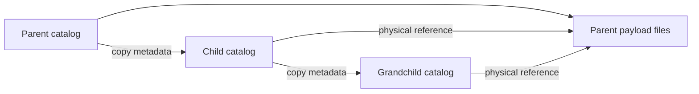

# Dataset composition

A child owns a complete catalog. It copies the parent metadata that it needs and can change that
metadata or add tasks. Large immutable bodies stay with their physical owner. Each body has a
reference that records an exact release, its manifest checksum, its codec, and its physical
location.

There are no catalog overlays. A child reader opens the child catalog and the required owner
manifests. It does not open parent catalogs to read inherited bodies. A grandchild references the
physical owners directly, so another generation does not add another lookup layer.



## What is copied and shared

| Content | Default policy |
| --- | --- |
| Records, Sources, Signals, axes, scopes, relationships | Copy into the child catalog. |
| Numeric and boolean annotation values | Keep inline and copy. |
| Text and text lists of at most 4 KiB | Keep inline and copy. |
| Larger annotation values, prompts, rationales, text targets | Pack into payload files and share references. |
| Signal values and irregular timestamp arrays | Store externally and share references. |

`inline_bytes` on `TimeFWriter` changes the text threshold. Use
`Payload.from_value(text, storage="external")` to store short text externally. Existing stored
references remain external when reused. The supported annotation bodies are scalars, text, and
lists of text. Binary attachments and document indexing require a separate extension.

Each annotation attachment has its own occurrence ID, span, and provenance. Attachments can share
one content ID and one large body. A child gets new content and occurrence IDs without duplicating
the stored body.

## Import a parent

```python
from timenet.dataset import TimeFDataset
from timenet.reader import TimeFReader
from timenet.registry import DatasetVersion
from timenet.writer import TimeFWriter

child = TimeFDataset(metadata=child_metadata)
with TimeFReader(DatasetVersion.open_local(parent_path)) as parent:
    imported = child.copy_from(
        parent, namespace="ecg", include_tasks=True
    )
    record = imported.records["parent-record-id"]
    record.metadata["reviewed"] = True
    with TimeFWriter(registry_root, child) as writer:
        writer.write()
```

`namespace` must be unique in the child. The mapper derives stable UUIDs from the child ID,
namespace, object kind, and original ID. Different parents can therefore use the same IDs. The
mapper updates scopes, targets, candidates, annotation references, vocabularies, and task
relationships together.

The returned object indexes imported Records, Sources, Signals, and annotation occurrences by
parent ID. `content_ids` maps annotation content IDs. `task_ref(parent_task_id)` returns a mapped
`TaskRef` without loading that task.

Use `record_ids=[...]` with `include_tasks=False` to import a subset. Task imports require the whole
parent catalog; the API does not guess how to repair a task graph after a subset selection.

Imported task sources remain replayable. Keep their reader open until writing finishes. The build
engine manages this lifetime for connectors. Mutable metadata is detached from the parent. Payload
handles are immutable and remain shared. To change a signal definition, construct a new Signal
with the imported `values` handle as its loader and a compatible specification.

## Add tasks through a connector

The card declares exact input releases:

```yaml
inputs:
  ecg: physionet/parent-ecg@1.0.0
```

The engine opens each input as an ordinary `TimeFReader`. It reuses an existing exact release, or
builds a missing release only if the installed connector declares that version. It detects input
cycles and keeps the readers open through conversion and writing.

```python
from timenet.connectors import BuildContext
from timenet.dataset import TimeFDataset
from timenet.types import AnswerTask


def convert(self, raw_refs, *, context: BuildContext) -> TimeFDataset:
    dataset = TimeFDataset(metadata=self.metadata())
    imported = dataset.copy_from(
        context.inputs["ecg"], namespace="ecg", include_tasks=True
    )
    dataset.add_task(task=AnswerTask(
        inputs=(imported.records["parent-record-id"],),
        prompt="What happened during maintenance?",
        targets=("The sensor was replaced.",),
    ))
    return dataset
```

Use `add_task_stream(task_types, source)` for large task sets. It appends a callable that returns a
fresh iterator. Local tasks and multiple sources can coexist. The writer checks IDs and derivation
cycles across the complete output. `from_tasks` holds lightweight `TaskRef` values. For a vocabulary
stored as an annotation, use `AnnotationContentRef(id=content_id)` as `target_schema`. A plain
string
names a schema and is not treated as an annotation ID.

## Read and export bodies

Construction accepts native values. Reading content is explicit:

```python
manual = annotation.value.read()
prompt = task.read_prompt()
answer = task.read_targets()
values = signal.values.read()
```

A marker annotation has `value=None`. Inspect `payload.descriptor` and `payload.reference` without
reading its body. Array handles also support `read_steps(start, stop)`.

Arrow exports use `payloads="references"` by default. External native value columns are null and
have explicit reference and descriptor columns. Use `payloads="materialize"` to fill the native
columns. SQL filters can use inline values and catalog metadata; they do not search external bodies.

## Runtime dependencies and standalone copies

`metadata.inputs` records build provenance. `manifest.payload_sources` lists only the flat physical
owners required at runtime. An owner can itself have unused inputs or payload dependencies; a child
does not download those. Downloads preserve owner manifest bytes and verify owned artifacts before
committing the child. `TimeFReader.verify()` also checks foreign payload files without requiring
foreign catalogs.

Reuse requires owners to remain available under the configured registry root. To move an output
without its owners, write a standalone copy:

```python
with TimeFWriter(new_root, child, payload_policy="copy") as writer:
    writer.write()
```

Copy mode transfers each required artifact once and preserves its codec and coordinates. It can
copy unused cells in a shared Parquet file or unused values in a Zarr array. This avoids decoding
and
repacking data. It rewrites references as local and removes runtime owner dependencies. Build
inputs and object lineage remain intact.

Registry stores accept the same policy. With reuse, publishing requires matching owner manifests
in the destination registry. Publish those owners first, or explicitly select copy mode. A
connector can set `payload_policy = "copy"` to produce standalone output.

## Migration from format 1

Format 2 is a breaking change. Rebuild old artifacts with the new writer; there is no legacy reader
or automatic converter. Update connector signatures to accept `context`, read annotation and task
content explicitly, and replace parent Task objects with `TaskRef` where identities are needed.

Upstream revisions belong in `source_revision`. `dataset_version` identifies the immutable TimeNet
release. Input declarations require `org/name@major.minor.patch` pins. Rebuilding a release changes
its manifest pin, so create a new version when other releases depend on it.
