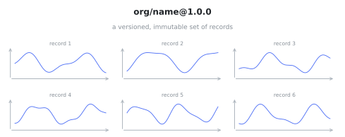

# Datasets

A dataset is a versioned collection of [records](records.md). Its address is `org/name@version`, for
example `chengsenwang/tsqa@1.0.0`. The id is a HuggingFace-style `org/name` pair. Dataset metadata
separates the TimeNet release from the original source:

| Field | Meaning | Example |
| --- | --- | --- |
| `dataset_version` | Version of the converted TimeNet dataset | `1.0.0` |
| `source_revision` | Optional release, tag, or commit of the original source | `v2.1` |

For example, a connector bug fix can produce TimeNet release `1.0.1` from the same source tag `v2.1`.
The `dataset_version` changes to `1.0.1`, while `source_revision` stays `v2.1`.

<figure markdown="span">
  
</figure>

## Versions are immutable

TimeNet commits a version atomically when its `manifest.json` lands. The version never changes after
that. A pinned `@version` gives you exactly those bytes. With no suffix (or `@latest`), you get the
newest committed version.

```python
from timenet.client import TimeNet

client = TimeNet()
client.load("chengsenwang/tsqa")          # latest committed version
client.load("chengsenwang/tsqa@1.0.0")    # a pinned, immutable snapshot
```

Immutability makes **full data lineage** possible downstream. Every batch a model trains on traces
back to the exact TimeF bytes of one version, not a moving target.

## Parent dataset cards

A dataset card's `parents` maps local aliases to exact parent releases. The output manifest stores
a copy of each parent's card in `parent_cards`. Each `ParentDatasetCard` holds that parent's
metadata, whose `dataset_id` and `dataset_version` identify the exact release.

For example, the alias `ptbxl` can name `physionet/ptb-xl@1.0.0`. Its parent card records that release
and its license, citation, access requirements, and other metadata. This copy lets readers inspect
the build's provenance without loading the parent dataset.

## Where a dataset lives

A [registry](../registry.md) serves committed TimeF versions to the [SDK](../client.md). It can be a
local directory, an S3 prefix, or a remote service. A registry never runs connector code. A local
[build](../build.md) output is also a registry, so the SDK can read it directly.
