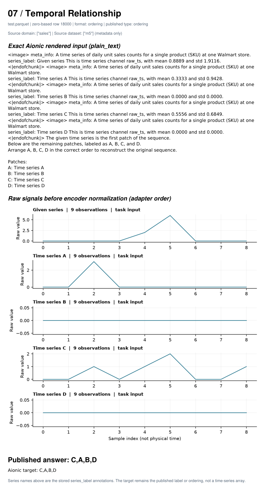
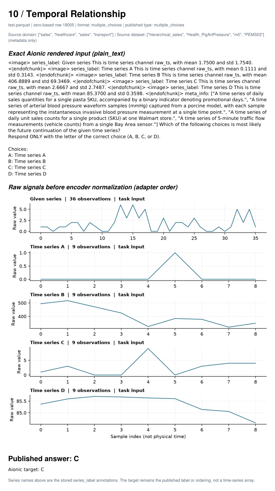

# TSAQA-clean: ordering disabled

Use `tsaqa/tsaqa-clean@1.0.0` to evaluate the raw TSAQA variant without temporal ordering tasks.
The complete `tsaqa/tsaqa-benchmark@1.0.0` parent is unchanged. The child keeps 180,111 tasks and all
510,093 raw signals, reusing the parent's signal files through TimeNet's dataset inheritance.

## Excluded: an order that the observations cannot distinguish

In test row 18000, B and D are identical nine-point zero arrays. Both `C,A,B,D` and `C,A,D,B`
reconstruct exactly the same sequence. Nevertheless, the published position-based scoring assigns
100% to the first label order and 50% to the second. The plot below shows the complete parent task;
this task is absent from the clean dataset.

## Retained: choose a continuation

Test row 18005 is still available. It asks for one candidate label, with the given sequence and all
four candidates supplied as labelled raw inputs. Its prompt, answer `C`, and values are inherited
unchanged. This example shows that disabling ordering does not disable temporal relationship tasks
as a whole.

The filter uses resolved `question_format`, preserving 10,000 continuation questions that the source
incorrectly labels as ordering. Excluding the entire ordering format is a conservative evaluation
choice, not a claim that every ordering question is ambiguous or that every retained question is valid.

Signal descriptions and series labels are inherited with their original signal associations.
The example above uses Aionic's per-series renderer: selected signal annotations appear inside
their corresponding media blocks. Filtering ordering tasks does not change those annotations.
