# TSAQA examples from the local registry

These twelve examples were reloaded from a fresh local build of
`tsaqa/tsaqa-benchmark@1.0.0`, using Hugging Face revision
`883dcb0f96e0d1c8fd3806f35548ff1f2058a9cd`. There are two examples for each task family,
including temporal ordering and continuation.

Each figure shows the complete prompt produced by Aionic's Flamingo renderer, every raw
series, and the published answer. Signal descriptions and labels appear inside the corresponding
media blocks. Extra series kept only for provenance are explicitly marked as excluded from model
inputs. Every observation is plotted in source order, with ordinal sample indices and an independent
y-axis scale. The plots show raw values; Aionic's renderer normalizes model inputs and reports their
original mean and standard deviation.

## Full dataset verification

The rebuilt registry contains **210,000 tasks, 285,042 records, 510,093 raw signals, and
35,774,717 observations**. Reloading the registry and comparing every task against its source row
verified raw values byte-for-byte, source identity, splits, prompts, answers, and annotation ownership.
The splits contain 147,000 training, 21,000 validation, and 42,000 test questions.
All 29,889 temporal ordering questions remain included in this dataset.

These are examples of the raw-input variant, not a reproduction of the paper's normalized-input
evaluation. Published answers and source ambiguities are preserved; an answer is not necessarily
uniquely inferable from its inputs.

## Classification

Both examples distinguish Gun and Point gestures. The signal description explains the source of these labels.

Test row 117 (zero-based).

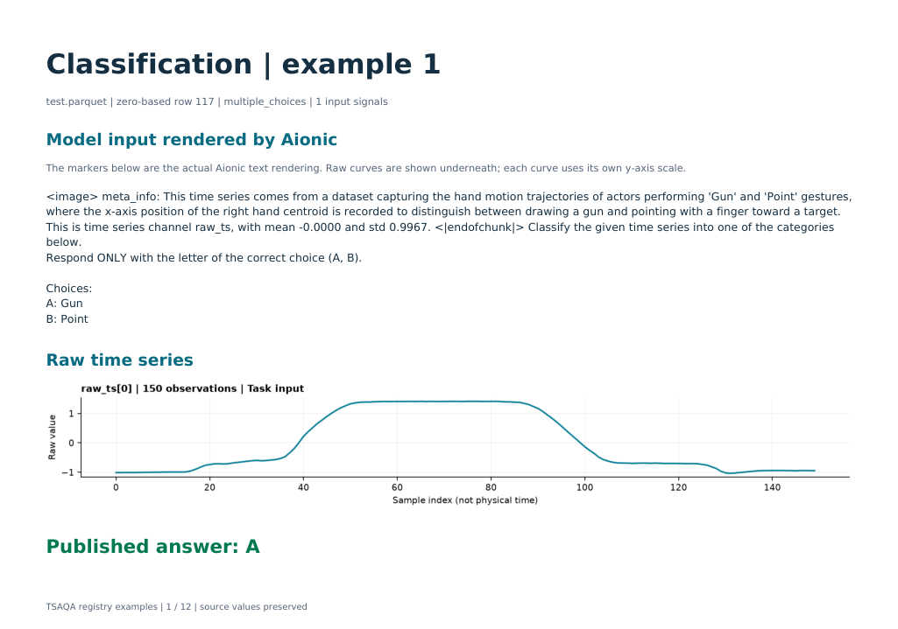

Test row 185 (zero-based).

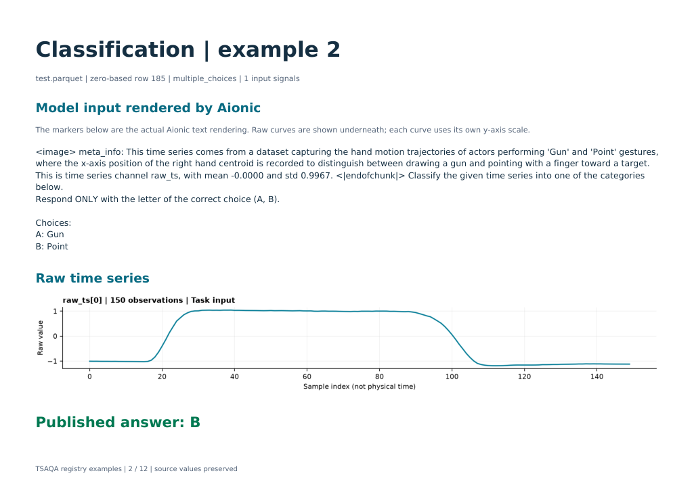

## Anomaly detection

The model receives one series and answers whether it contains an anomaly.

Test row 6000 (zero-based).

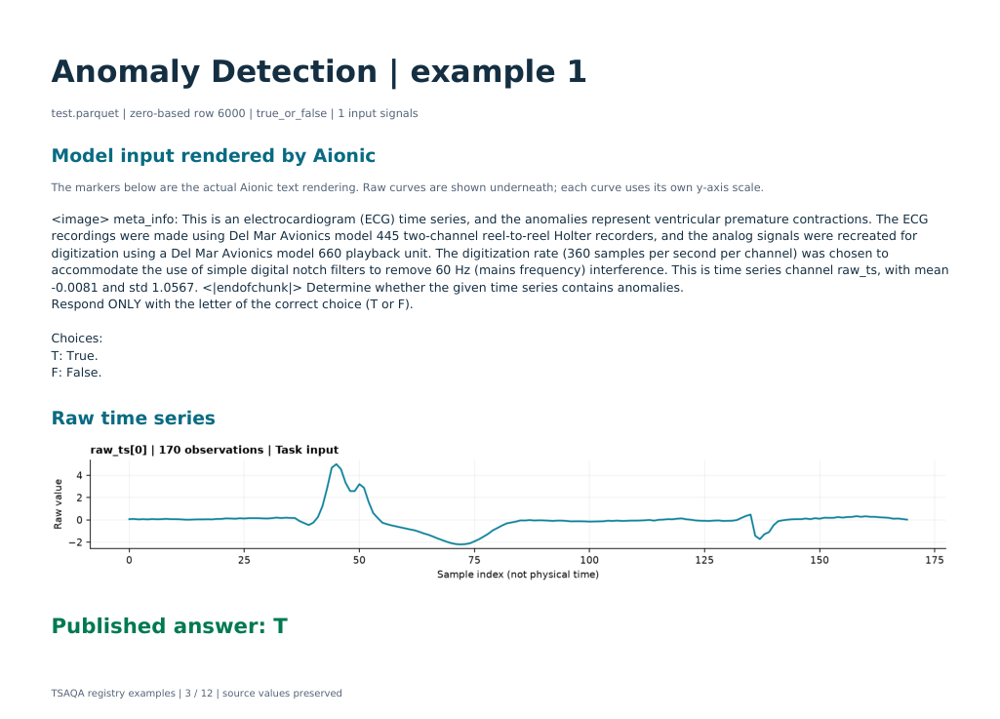

Test row 6001 (zero-based).

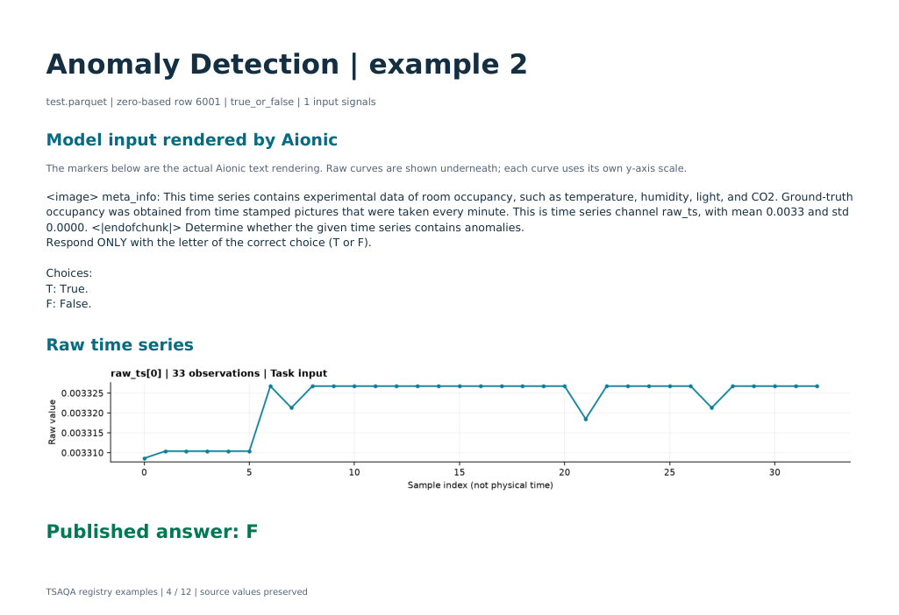

## Characterization

These examples ask about seasonality and stationarity. Both source series are constant; the published answers are retained.

Test row 13021 (zero-based).

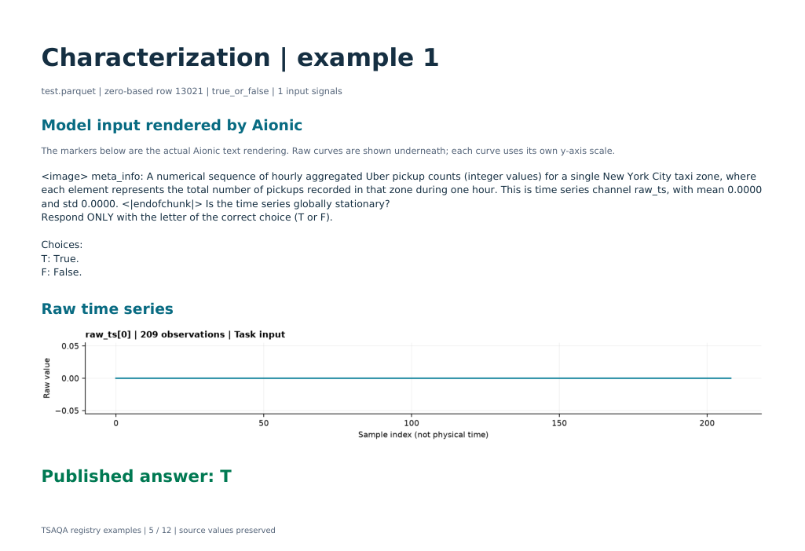

Test row 16835 (zero-based).

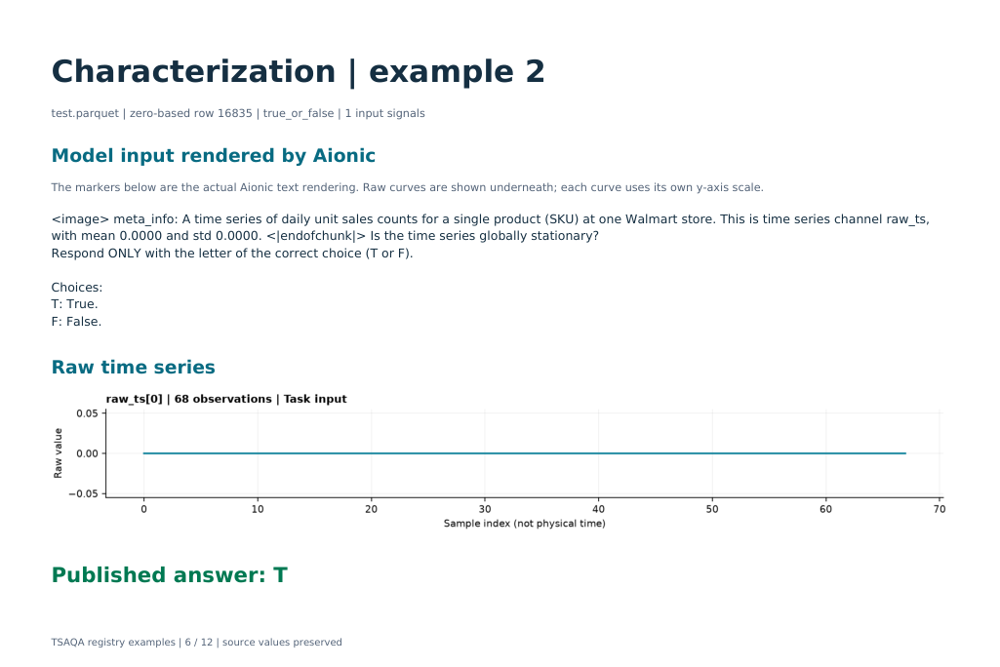

## Comparison

Each question compares two input signals. Each signal carries its own source description.

Test row 25243 (zero-based).

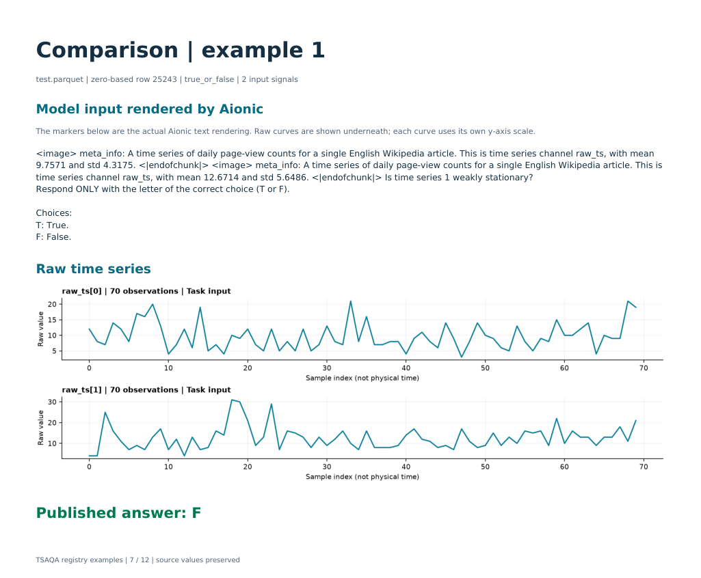

Test row 26778 (zero-based).

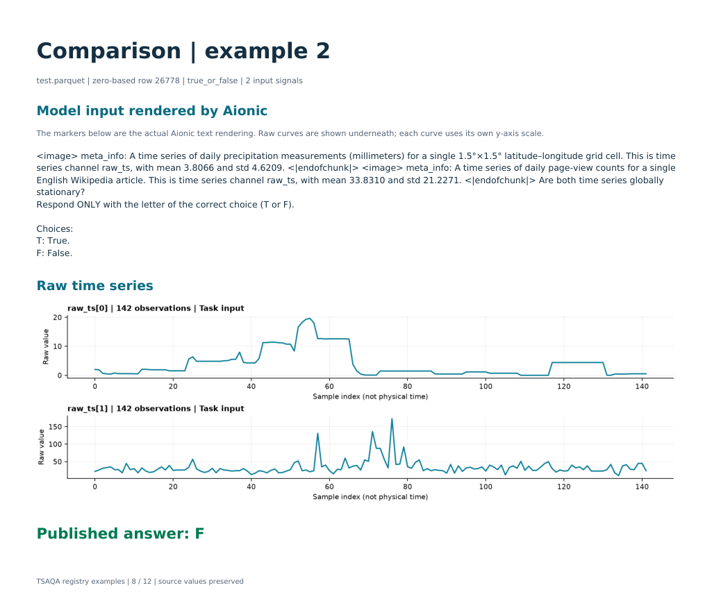

## Data transformation

Each question supplies a proposed transformation as text. The additional raw series is retained for provenance and is not a model input.

Test row 31822 (zero-based).

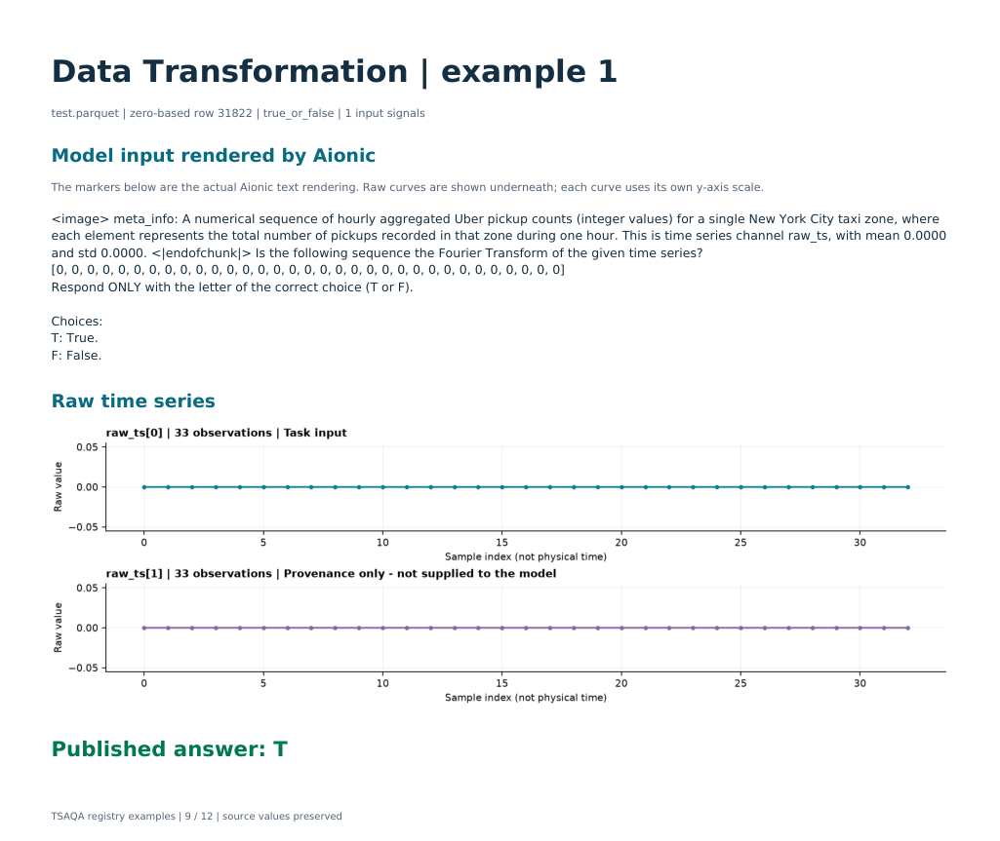

Test row 32886 (zero-based).

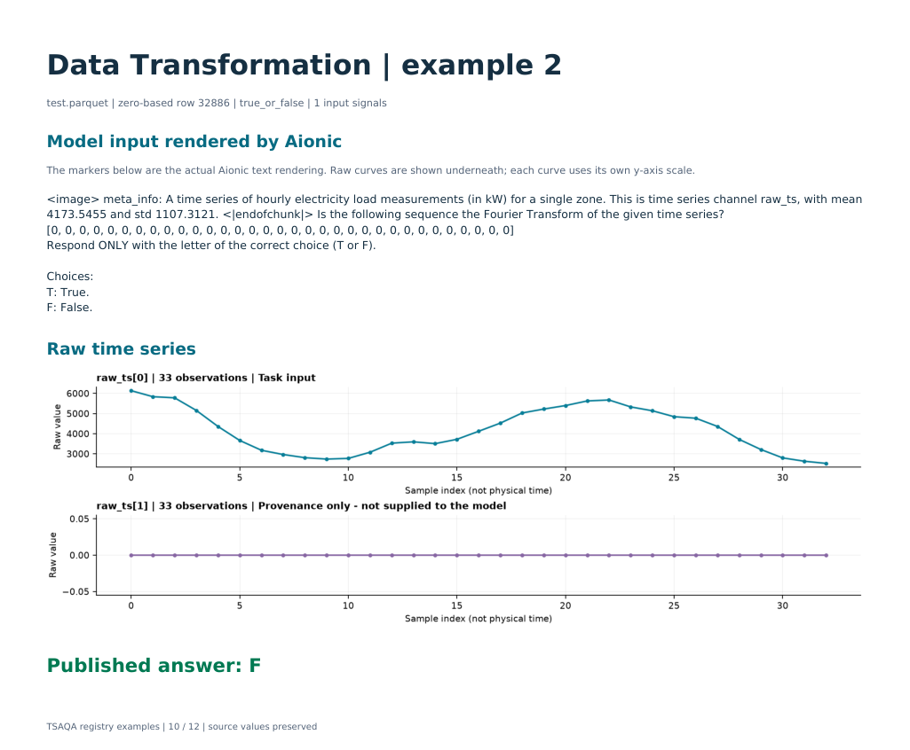

## Temporal relationship

The first example asks for patch ordering; the second asks for a continuation. Both include all five labelled input signals. The ordering example contains identical patches, so its published ordering is ambiguous.

Test row 18000 (zero-based).

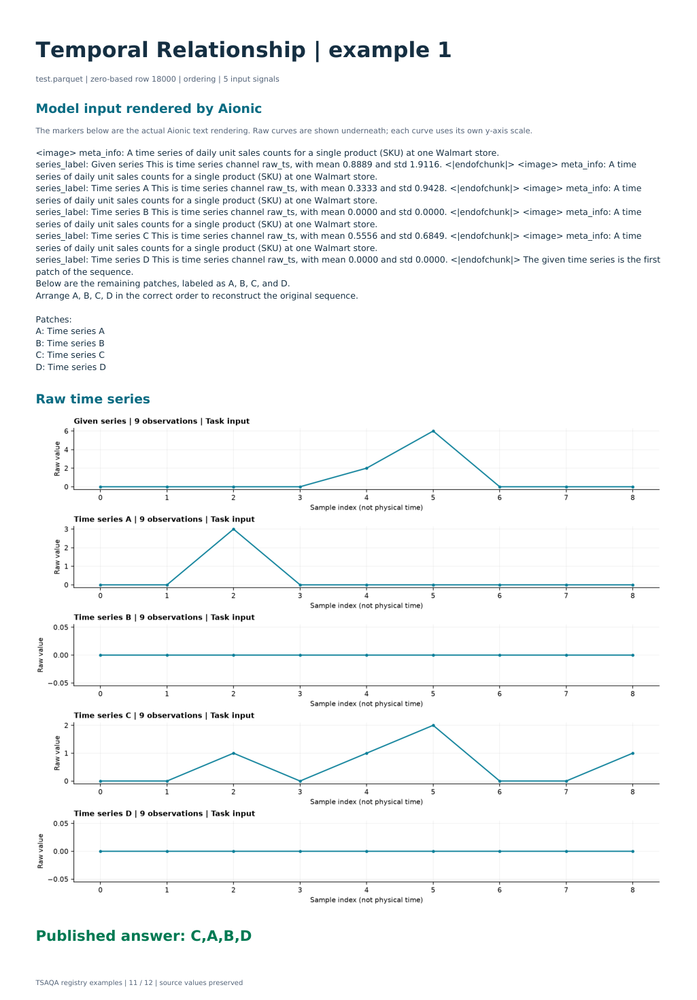

Test row 18005 (zero-based).

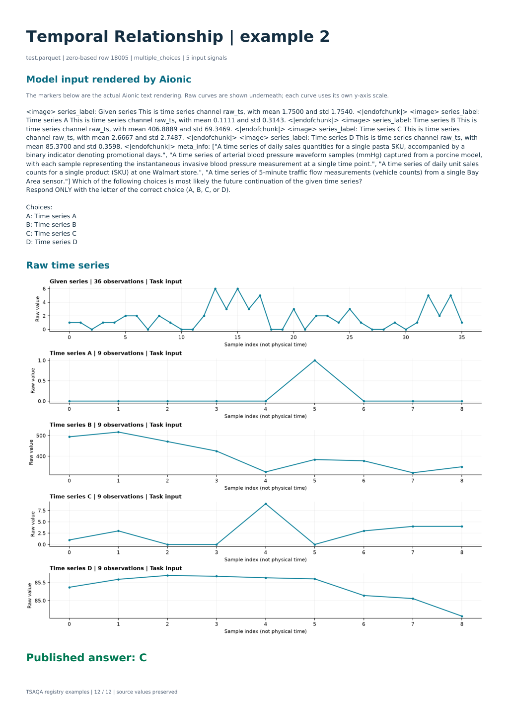

## Context belongs to its signal

The connector parses `meta_info` into descriptions and attaches each known description with
`Signal.annotate()`. Temporal labels use the same API. Tasks reference those exact occurrences
through `input_annotations`, so Aionic places the description and label inside the corresponding
series block, before its channel statistics.

Multiple-choice candidate rows have four descriptions for five raw series without a confirmed
association. Their original context remains unscoped and carries `ambiguous_series_context`;
labels still belong to their individual signals. The renderer normalizes numerical inputs and
includes their original mean and standard deviation. These figures plot the stored raw values.
