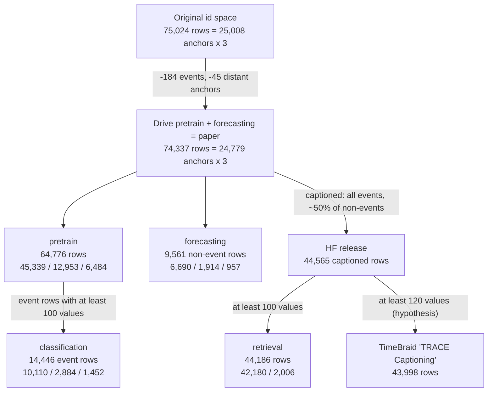

# TRACE Weather

TRACE pairs multivariate weather station series with NOAA severe weather event reports and
LLM-generated captions. It accompanies [TRACE: Grounding Time Series in Context for Multimodal
Embedding and Retrieval](https://arxiv.org/abs/2506.09114) (NeurIPS 2025). The paper's code lives
in [TRACE-Multimodal-TSEncoder](https://github.com/Graph-and-Geometric-Learning/TRACE-Multimodal-TSEncoder).

The authors publish two releases of the same data:

| Release | Pin | Content |
| --- | --- | --- |
| [Hugging Face](https://huggingface.co/datasets/catherpker/TRACE-TimeseriesRAG-Dataset/tree/3e02bda9740792d4eeba63ff398ecbb660c086f3) | revision `3e02bda` | 44,565 captioned station windows and 4,855 event reports, as raw JSONL |
| [Google Drive](https://drive.google.com/file/d/1hX4D91QbXa0UQlgf6Jnf-1ii96gfp1aY/view) | sha256 `a5d24d75…be58` | The preprocessed `dataset/` folder that the code loads, with the authors' splits |

[The TimeNet dataset](#the-timenet-dataset) describes what the connector builds. The later
sections document the source data. Read [The authors' splits](#the-authors-splits) before
comparing results with the paper or with other models trained on TRACE. Neither release states
a data license (see [Data limitations](#data-limitations)).

## The TimeNet dataset

The connector reads the Drive archive, the release the authors' code loads. It downloads the
archive once, checks its sha256, and extracts it. The build fails if a split file's row count or
event count differs from the pinned archive.

### Records

The dataset has one Record per window, 74,337 in all: every window of the paper.

- **Signals.** A window's seven channels are Signals of one station Source. `start_time` is the
  window's first timestamp, read as UTC (see [Windows](#windows)). A window without gaps has a
  regular axis at its mode's cadence (60,514 windows). A window with gaps keeps its explicit
  offsets (13,823 windows).
- **Metadata.** Each Record's metadata holds its original `id` (`source_id`), its `anchor`
  (`id // 3`), its source file, and its station, coordinates, location, and mode. No task reads
  them, so they are not annotations.

| Channel | Unit | Spec |
| --- | --- | --- |
| `temperature` | °C | float32 |
| `precipitation` | mm | float32 |
| `relative_humidity` | % | float32 |
| `visibility` | km | float32 |
| `wind_u` | m/s, eastward | float32 |
| `wind_v` | m/s, northward | float32 |
| `sky_code` | GHCN-h sky cover code, 0–10 | `enum` codebook |

The units come from the field table in the Hugging Face card. The Drive archive and the code
state none. The ranges fit them: visibility tops out at 16.09 km, the 10-mile reporting cap.

The card calls `sky_code` "0–8 oktas", but the data also holds code 9, in 23,964 values. These are
GHCN-h sky cover codes, as listed in [NCEI's hourly coverage code table][ncei-sky]. Codes 00–08
count oktas, 09 means the sky is obscured, and 10 means partial obscuration. Codes 09 and 10 are
not amounts, so the connector stores the channel as an `enum` with one label per code. The
paper's prompt (Appendix B.4) labels the same codes with fractions that mix eighths and tenths.

[ncei-sky]: https://www.aos.wisc.edu/oldsco/stations/NCEI-hrly-doc_for_clds-BNA.txt

### Event-type classification

One `ClassificationTask` per event window that the authors classify: the 14,446 `pretrain`
windows with an event and at least 100 values. The task keeps the authors' split: 10,110 train,
2,884 validation, and 1,452 test.

- **Input.** The Record only, with no prompt and no input annotations. The authors' classifier
  sees only the series (see [Events](#events)).
- **Target.** The NOAA event type. Each task's `target_schema` is `trace-noaa-event-types`, the id
  of the dataset's `event_type_vocabulary` annotation, which lists the nine types in the
  authors' label order:

  | Label | Event type |
  | --- | --- |
  | 0 | Lightning |
  | 1 | Debris Flow |
  | 2 | Flash Flood |
  | 3 | Heavy Rain |
  | 4 | Tornado |
  | 5 | Funnel Cloud |
  | 6 | Hail |
  | 7 | Flood |
  | 8 | Thunderstorm Wind |

- **Rationale.** The window's NOAA event report, as the authors' `generate_er` writes it (see
  [Generated text](#generated-text)). It comes from `retrieval/*.parquet`, which holds exactly
  one report per classified window.
- **Metadata.** The label index and the report's `event_id`. 4,848 events cover the 14,446 tasks,
  most of them with all three windows. The `event_id` ties together an event's windows, which
  the authors' split often separates, so use it to group or deduplicate.

The rationale is supervision only, never an input. It names the target, and its narrative
describes what happened after the window ended, such as damage, rainfall totals, and
evacuations. It is an event report written by people, not reasoning from the observed series. A
model trained to produce it learns to write a plausible report for the predicted type.

### Captioning

One `AnswerTask` per row of `retrieval/*.parquet`: the 44,186 captioned windows with at least 100
values, event and non-event alike. The task keeps the authors' retrieval split: 42,180 train and
2,006 test.

- **Input.** The Record, and TimeBraid's captioning prompt (arXiv:2609.29792, Figure 17).
- **Target.** The window's description, as the authors' `generate_dsp` writes it (see
  [Generated text](#generated-text)).

This follows TimeBraid's use of TRACE as a captioning source. TimeBraid publishes neither its
prompt nor its target text for TRACE. The prompt is the one its paper shows for captioning
examples, not one confirmed for TRACE. The target is the only full-window caption the TRACE code
defines. See [TimeBraid's use of TRACE](#timebraids-use-of-trace) for how to select its rows.

### Windows by task

Every window falls into one of four groups:

| Windows | Count | Classification | Caption |
| --- | --- | --- | --- |
| Event windows of `pretrain` with at least 100 values | 14,446 | yes | yes |
| Other captioned windows with at least 100 values | 29,740 | no | yes |
| Non-event windows without a caption | 29,772 | no | no |
| Captioned windows under 100 values, 119 of them event windows | 379 | no | no |

Only `pretrain` windows can have a classification task. `forecasting` windows carry no
`event_type`, because the authors use them only for forecasting fine-tuning. The authors
captioned only half the non-event windows (see [How the releases relate](#how-the-releases-relate)),
and their classification and retrieval files drop windows under 100 values.

The connector keeps the 30,151 Records without a task, because they are part of the authors'
data, not because a current task uses them. They keep the dataset whole: all 74,337 windows of
the paper, with the authors' split membership in each Record's `source_file`. A later task, such
as forecasting on the `forecasting` split, can use them without changing the Records.

### Dataset annotations

| Annotation | Value |
| --- | --- |
| `event_type_vocabulary` | The nine event types, in label order |
| `no_event_label` | `-100`, the source's label for a non-event window, which no task uses |

## Source data

### Windows

Each window comes from one NOAA GHCN-h station. Both releases carry the same fields for it: the
window's `id`, the station's `station_id`, coordinates, and `location`, the window's `mode`, a
`DATE` timestamp per value, and the seven channels. In the Drive files, `pretrain` windows also
carry an `event_type`. `pretrain` windows publish their location as `"COUNTY,STATE"`, and most
`forecasting` windows as a list such as `["County", "State"]`.

Every anchor, meaning a station and an end date, yields three windows:

| `mode` | Cadence | Span | Typical length |
| --- | --- | --- | --- |
| `7day_hourly` | 1 hour | 7 days | 168 |
| `28day_4hourly` | 4 hours | 28 days | 168 |
| `180day_daily` | 1 day | 180 days | 180 |

The timestamps have no timezone. Read as UTC, every timestamp falls on its mode's grid. Read as a
local zone that observes daylight saving time, some days appear to last 23 or 25 hours. Some
windows have gaps, meaning missing grid points: 13,823 of the 74,337 Drive windows, and 8,462 of
the 44,565 HF rows. A window with gaps is shorter than the typical length.

### Events

`event_report.jsonl` holds 4,855 NOAA Storm Events reports. Each has an `event_id`, an
`event_type` name, a state, a county or zone, begin and end times, a `narrative`, and
`ts_dict_index`, which links the report to its three windows.

> [!WARNING]
> **`ts_dict_index` holds `id` values, not line numbers.** The upstream README says `id` equals
> the 0-based line position. In the pinned release that holds for only 3 rows, and
> `ts_dict_index` resolves correctly only as `id` values. Resolved that way, every link points
> to a window at a station in the event's state. Resolved by line number, the links point to
> unrelated windows.

Event-linked windows end 0–4 days **before** the event begins. They are pre-event history, which
is why the paper calls its classification task "multi-class event prediction". An event
narrative describes what happened after its window, so it must never be an input to a task on
that window.

The code classifies nine event types. It sets `num_class: 9`, and masks label −100 out of the
classification loss and metrics, so non-event windows never count toward classification. The
`classification` arrays hold no non-event label. Paper Appendix B.5 lists `None` as a category,
but the code does not train or score it. The classifier sees only the series: its head reads the
time-series encoder output before any text is fused, and TRACE defines no language-model
prompt.

### Generated text

ChatGPT wrote a description of each captioned window, from the window's location, its dates, and
its series (paper Appendix B.3–B.4). The description has a sentence for each of the seven
channels, a `DATE` sentence, a `location` sentence, and a `labels` keyword list such as
`Cold, Rainy, Cloudy, Windy`. The generation prompt asks for keywords from a set of ten: Clear,
Cloudy, Rainy, Snowy, Windy, Foggy, Hot, Cold, Humid, and Stormy. The prompt does not mention the
event, and the paper reports no human validation. The Hugging Face release wraps `labels` in
brackets; the retrieval parquet files do not.

The code turns the descriptions and event reports into text with three templates in
`src/data/load_data.py`. Text enters training only as contrastive alignment targets for the
text encoder:

| Text | Built by | Template |
| --- | --- | --- |
| Sample description | `generate_dsp` | `Weather time series location: {location} Time range: {DATE} The weather is {labels}.`, then the seven channel sentences joined by ` \n ` |
| Channel descriptions | `generate_channel_description` | The seven channel sentences, one per channel |
| Event report | `generate_er` | `The weather event is {event_type}. {narrative}`, or `No severe weather event.` |

The Hugging Face narratives agree with the retrieval parquet's, except that event 1065296's
narrative differs by one character.

### Drive archive layout

The Drive archive unpacks to the `dataset/` folder that the code's loaders read. It is 487 MiB
(510,759,681 bytes) zipped and 1.75 GB unpacked, in 78,704 files. Each folder is one task's
split:

| Folder | Train | Val | Test | Content |
| --- | --- | --- | --- | --- |
| `pretrain/*.json` | 45,339 | 12,953 | 6,484 | Windows keyed by `id`, with `event_type` 0–8, or −100 for no event |
| `pretrain/*_data/*.npy` | 44,936 | 12,857 | 6,421 | The same windows as arrays, after dropping short ones |
| `classification/*_data/*.npy` | 10,110 | 2,884 | 1,452 | The event windows of `pretrain`, with at least 100 values |
| `forecasting/*.json` | 6,690 | 1,914 | 957 | Non-event windows keyed by `id`, split by whole anchor |
| `retrieval/*.parquet` | 42,180 | — | 2,006 | Captioned windows with at least 100 values, plus descriptions and event reports |

The JSON files carry no captions; only the retrieval parquet files and the HF release do. The
`pretrain` and `forecasting` JSON counts match Table 8 of the paper exactly. The `val` files hold
20% of each subset and the `test` files hold 10%. The released `PretrainingDataset` defaults to
`val_ratio=0.1, test_ratio=0.2`, but the published files are split the other way.

The repository loads these files through `src/data/load_data.py`, and never reads the Hugging
Face release. Code references are to commit [`1b65246`][trace-code].

| File | Loader | Reached from |
| --- | --- | --- |
| `pretrain/*_data/*.npy`, `labels.npy` | `load_npy_timeseries` | `pretrain.py`: Stage 1 pretraining and classification |
| `retrieval/*.parquet` | `load_retrieval_from_parquet` | `context_align.py`: Stage 2, and `demo.ipynb` |
| `forecasting/*.json` | `load_forecasting_from_json` | `forecast_finetune.py`: Stage 3 |
| `classification/*_data/*.npy` | `load_npy_timeseries` | Nothing: no config or script selects `task_name: classification` |
| `pretrain/*.json` | `load_timeseries_from_json` | Nothing: its call in `PretrainingDataset` is commented out |

The `.npy` arrays carry no `id`, but they follow the JSON files. The k-th file in a
`pretrain/*_data` folder, in sorted name order, holds the k-th window of the matching JSON file
that has at least 100 values. `classification` follows the same order, restricted to event
windows. This was checked value by value for `pretrain/test` (6,421 arrays), `classification/test`
(1,452), and `classification/val` (2,884). The other folders match by count. The connector
therefore takes ids and splits from the JSON files.

`classification/` has train, val, and test folders of arrays, but no JSON files. It is not a
separate split: its arrays are the event windows of the `pretrain` arrays, with the same split.
The file dates show the order of derivation: `pretrain/*.json` on 2025-04-17, the `pretrain`
arrays on 04-19, and the `classification` arrays on 04-22. No released script reads the folder.
The paper's classification results come from Stage 1, which scores its classification head on
the `pretrain` split.

`retrieval/` has no validation file because Stage 2 never asks for one. `Tasks.__init__` in
`src/tasks/base.py` loads a validation split for every task except `retrieval`. Stage 2 evaluates
on the test split after every epoch, so the test set is the only held-out signal it sees,
including for choosing a checkpoint.

The repository contains no script that builds any of these splits. The sampling, seeds, and
ratios behind them are not published.

[trace-code]: https://github.com/Graph-and-Geometric-Learning/TRACE-Multimodal-TSEncoder/tree/1b6524630cb3079754e17f7c88c88d820645096a

### How the releases relate

`id` runs from 0 to 75,023. The ids are the authors' original numbering, kept after rows were
removed. They form 75,024 slots, which is 25,008 anchors of three windows each. Every complete id
triplet `3k, 3k+1, 3k+2` is one station in `7day_hourly`, `28day_4hourly`, `180day_daily` order.
The slots split into three contiguous blocks that match the paper's Appendix B.1–B.2:

```text
id   0             15,117                      ~43,975                    75,023
     |-------------|---------------------------|--------------------------|
     | event       | non-event, same stations  | non-event, distant       |
     | associated  | as the events             | stations                 |
     |-------------|---------------------------|--------------------------|
slots  15,117        ~28,860                     ~31,047
       5,039 x 3
Drive  14,565        all                         all but 135 (45 anchors)
       (184 events   \__ 74,337 rows: the paper's dataset __/
        removed)
HF     14,565        14,563                      15,437
                     ~50% random sample          ~50% random sample
                     \_______ exactly 30,000 captioned rows _______/
```

Both releases were checked against each other:

- The Drive `pretrain` and `forecasting` ids together are exactly the paper's 74,337 instances.
  No id appears in two splits or two tasks.
- All 44,565 HF ids appear in Drive, with identical channel values and timestamps.
- All 14,565 event labels in Drive agree with the HF event reports.
- The 687 slots missing from Drive are 229 whole anchors: the 184 events missing from HF, and 45
  anchors from distant stations. Neither release says why they were removed.

The HF release contains only the windows that received a generated caption. Appendix B.3 of the
paper explains the selection:

> We use ChatGPT to generate channel-level textual descriptions for selected TS samples, where
> all TS samples linked to event reports are included. We also randomly select 50% of TS samples
> from both the non-event windows at event-associated stations and the non-event-associated
> stations to generate channel-level descriptions for event-label balance.

The non-event rows show that selection directly. Exactly 30,000 rows survive from the ~59,800
non-event windows, about half of each block. Rows were sampled independently, not by anchor.
Across anchors, the share keeping 0, 1, 2, or 3 of its windows is close to 1:3:3:1, the pattern
for independent coin flips. The window modes are also unbalanced (10,110 daily, 9,957 hourly,
9,933 four-hourly).

Every subset the code and TimeBraid use derives from these ids:



## The authors' splits

The code uses three independent splittings of the same windows:

| Splitting | Unit | Used for |
| --- | --- | --- |
| `pretrain`, and `classification` within it | single window, at random | Stage 1 pretraining and event classification |
| `forecasting` | whole anchor | Forecasting fine-tuning |
| `retrieval` | single window, at random | Stage 2 alignment and retrieval evaluation |

The `pretrain` split assigns windows individually, so an anchor's three windows often land in
different splits. 13,983 of 24,687 pretraining anchors span more than one split. The three
windows of an anchor end on the same date and overlap in time. The three windows of event
1065296 (Debris Flow, Madera, California) fall in train, val, and test respectively. An evaluation
on the authors' test split therefore sees series that overlap training series, and event
reports that also label training windows.

The `retrieval` split covers the 44,186 HF rows with at least 100 values. Its train and test sets
do not overlap. It splits about 95.5% to 4.5%, and events make up a similar share of each side:
13,787 of 42,180 train windows (32.7%) and 659 of 2,006 test windows (32.9%). The test set is the
paper's "2,000 bidirectional Text–Timeseries query pairs" (Table 1).

The `retrieval` split ignores the `pretrain` split:

| `retrieval` test windows | Split they belong to elsewhere |
| --- | --- |
| 1,232 | `pretrain` train |
| 341 | `pretrain` val |
| 197 | `pretrain` test |
| 236 | `forecasting` |

Stage 2 starts from the Stage 1 encoder, so most retrieval test windows are windows that encoder
was trained on. The two stages' held-out sets differ. Retrieval needs a caption, and only
captioned windows can serve, which may be why `retrieval` does not reuse the `pretrain` split.
The code does not say.

## TimeBraid's use of TRACE

TimeBraid ([arXiv:2609.29792](https://arxiv.org/abs/2609.29792), Table 8) trains on "TRACE
Captioning" with 43,998 samples and does not describe its filter. Dropping HF rows with fewer than
120 values per channel removes exactly 567 rows, leaving 43,998. Nearby thresholds miss: a cutoff
of 119 removes 546 rows, and 121 removes 584. This exact match is the best available explanation,
but it is a hypothesis, not a documented recipe.

The same filter on the retrieval files gives the same 43,998 windows: 42,002 in `retrieval`
train and 1,996 in test. To approximate TimeBraid's source, keep the caption tasks whose input
window has at least 120 values, through the signals' `n_values`. TimeBraid's prompt and target
text for these rows are not published, so matching the rows does not reproduce its training
examples.

## Source inventory

These tables list every piece of information the releases, the code, and the paper provide,
and whether the connector uses it. Abbreviations:

- **Drive JSON**: `pretrain/*.json` and `forecasting/*.json`.
- **Drive arrays**: `pretrain/` and `classification/` `*_data/*.npy`, with `labels.npy`.
- **Parquet**: `retrieval/*.parquet`.
- **HF**: the Hugging Face `mmts.jsonl` and `event_report.jsonl`.

### Per window

| Information | Available in | Covers | Produced by | Connector |
| --- | --- | --- | --- | --- |
| Window id | Drive JSON keys, Parquet `id`, HF `id` | 74,337 / 44,186 / 44,565 | Authors | Record id `trace-<id>`, `metadata.source_id` |
| Anchor (`id // 3`) | Derived from the id | 74,337 | Derived | `metadata.anchor` |
| Station id | Drive JSON, HF | 74,337 / 44,565 | GHCN-h | Source name, `metadata.station_id` |
| Latitude, longitude | Drive JSON, HF | 74,337 / 44,565 | GHCN-h | Metadata |
| Location | Drive JSON, HF | 74,337 / 44,565 | Authors | `metadata.location`, as published |
| Sampling mode | Drive JSON, HF | 74,337 / 44,565 | Authors | `metadata.mode` and the axis cadence |
| Timestamps (`DATE`) | Drive JSON, HF | 74,337 / 44,565 | GHCN-h, resampled by the authors | `start_time` and the axis offsets |
| Seven channel values | Drive JSON, HF, Drive arrays, Parquet `timeseries` | 74,337 / 44,565 / 64,214 / 44,186 | GHCN-h | Seven Signals, read from Drive JSON only |
| Pretrain or forecasting split | Drive JSON file location | 74,337 | Authors | Classification task `split`, `metadata.source_file` |
| Array folder membership | Drive arrays | 64,214 / 14,446 | Authors | Not read; the same split as the JSON |
| Retrieval train or test split | Parquet | 44,186 | Authors | Caption task `split` |
| Event type label (0–8, or −100) | Drive pretrain JSON, `labels.npy`, Parquet `events.event_type`, HF `event_type` | 64,776, of which 14,565 events | NOAA, linked by the authors | Classification target; −100 only as `no_event_label` |
| Channel, date, and location sentences | Parquet `description`, HF `description` | 44,186 / 44,565 | ChatGPT | Caption target, from the Parquet |
| Weather keywords (`labels`) | Parquet, HF | 44,186 / 44,565 | ChatGPT | Caption target, as the Parquet writes them |
| Forecast target (the last H values) | Derived by the code from `forecasting` windows | 9,561 | Derived | Not used: no forecasting task yet |

The channel values in HF are identical to Drive JSON for every shared window. The Drive arrays
match where they were compared. The Parquet `timeseries` bytes were not compared.

### Per event

| Information | Available in | Covers | Produced by | Connector |
| --- | --- | --- | --- | --- |
| Event id | Parquet `events.event_id`, HF | 4,848 / 4,855 events | NOAA | Classification task `metadata.event_id` |
| Event narrative | Parquet `events.narrative`, HF | 14,446 / 14,565 windows | NOAA, written by people | Classification task `rationale`, from the Parquet |
| Event type name | HF; `EVENT_MAP` maps the indices | 4,855 | NOAA | Classification target and `event_type_vocabulary` |
| State, county or zone | HF only | 4,855 | NOAA | Not used |
| Begin and end time | HF only | 4,855 | NOAA | Not used; it would give the time to the event |
| Links from events to windows (`ts_dict_index`) | HF only | 14,565 links | Authors | Not used; the Parquet keys reports by window id |

### Code and paper

| Information | Available in | Connector |
| --- | --- | --- |
| Event label names and order (`EVENT_MAP`) | Code, `src/common.py` | `event_type_vocabulary`, the target schema |
| No-event label −100 | Code, `EVENT_MAP` | `no_event_label` |
| Minimum of 100 values for classification | Code (`>= 100` filters), Drive arrays | `MIN_CLASSIFICATION_VALUES` |
| `generate_er` template | Code | Rationale text |
| `generate_dsp` template | Code | Caption target text |
| `generate_channel_description` template, `No severe weather event.` | Code | Not used |
| Captioning prompt | TimeBraid paper, Figure 17 | Caption task prompt; not confirmed for TRACE |
| Channel units | HF card | Signal specs |
| Sky cover codes 00–10 | Paper B.4 prompt; NCEI code table | `enum` codebook with NCEI labels |
| Split counts | Paper Table 8 | Pinned `SOURCE_FILES`, checked at build time |
| Archive bytes | Drive | Pinned sha256 |
| Citation, source link | Paper, Drive | Card |
| Generation prompt, keyword vocabulary | Paper B.3–B.4 | Not used |
| Text encoder and cached embeddings | Code, configs | Not used |
| Forecast horizons (H = 7 for weather) | Paper Table 5, `configs/finetune.yaml` | Not used |
| TimeMMD subsets | Code `MMDataset`, a separate repository | Not used; a separate dataset |
| Split method, seeds, ratios | Not published | — |
| Why 184 events and 45 anchors were dropped | Not published | — |

## Data limitations

- **Generated captions.** In a 646-row sample, 7.7% of the "between X and Y" or "from X to Y"
  range claims missed the series' actual minimum or maximum by more than 1 unit and more than
  10% of the range. Some `wind_v` sentences repeat the `wind_u` range, or call `wind_v` the
  "vertical" component when it is northward. These sentences are the caption tasks' targets, so
  a model trained on them also learns their errors.
- **Label keywords.** Besides the ten keywords the prompt asks for, the `labels` field contains
  other words (`Warm`, `Dry`, `Cool`) and stray braces (`{Clear`, `Windy}`).
- **Short windows.** 379 HF rows have fewer than 100 values, and 15 have a single value. They are
  Records without a task.
- **Implausible values.** The archive keeps upstream values that fail basic range checks, and the
  connector stores them as published. 13,748 relative humidity values in 2,079 windows exceed
  100%, up to 81,265%. 58 temperatures in 47 windows exceed 60 °C, up to 438 °C. 29,103
  visibility values in 724 windows exceed the 16.09 km cap, up to 225 km.
- **Aggregation.** The archive does not say how 4-hourly and daily values were aggregated from
  hourly readings, for example whether precipitation is a sum or a mean.
- **Duplicates.** 10,903 HF rows repeat another row's station and channel values exactly, and
  10,900 repeat its station and window dates. Some of those copies carry different captions.
- **Split leakage.** The authors' splits separate windows that overlap in time and share an
  event. See [The authors' splits](#the-authors-splits).
- **Availability.** The Drive archive has no immutable revision. Its sha256 detects a change but
  cannot recover the pinned version.
- **License.** Neither release nor the code repository states a license. CC BY-NC-ND 4.0 on
  arXiv covers the paper, not the data.

The counts in this README come from full passes over both releases at their pins. The one
exception is the caption range check, which comes from the first 646 HF rows.
